# Worksheet 2 — Secure SDLC & Tooling (3 hrs)

> **Course:** Software Security (KOSEN69) · **Week 2**
> **Aligned to:** OWASP 2025 (A05 Injection [CWE-89, CWE-78], A04 Cryptographic Failures [CWE-327], A02 Security Misconfiguration [CWE-798, CWE-489]) · CWE-798, CWE-89, CWE-78, CWE-327, CWE-489
> **Signature game:** "Bug Triage Race" (scan → triage; score = true positives − misclassified)

> **Ethics note:** The scanners run only against the provided `vulnerable-repo/` on your own machine. Do not point SAST/secret scanners at third-party repos or production systems without authorization. Treat any secret you find here as fake lab data.

## Part 1 — Student Information
| Name | Student ID | Date | Group |
|---|---|---|---|
| Nararat Kritphet | 6631503110 | | |

## Part 2 — Lecture Questions
Answer in your own words (2–4 sentences each).
1. Distinguish SAST, DAST, and SCA — what does each see, and when in the SDLC does each run?

SAST analyzes source code without running the application to find security weaknesses during development. DAST tests a running application from the outside to identify vulnerabilities while testing or in staging. SCA checks third-party libraries and dependencies for known vulnerabilities and licensing issues, usually during development and CI builds.

2. What is secret scanning, and why do hardcoded secrets keep ending up in repos?

Secret scanning searches source code and repository history for sensitive information such as passwords, API keys, and access tokens. Hardcoded secrets often end up in repositories because developers accidentally commit configuration values, copy credentials into code for testing, or forget to remove temporary secrets before pushing.

3. What does "shift-left / DevSecOps" mean in practice for a CI pipeline?

Shift-left means introducing security checks earlier in the software development process instead of waiting until the application is finished. In a CI pipeline, this means automatically running tools such as SAST, SCA, and secret scanning whenever code is pushed or a pull request is created. DevSecOps makes security a shared responsibility throughout development.

4. Why is coverage-guided fuzzing considered the dominant modern bug-finding technique?

Coverage-guided fuzzing uses code coverage feedback to learn which inputs reach new parts of the program. It automatically generates and mutates inputs to explore more execution paths and discover unexpected crashes or bugs. This makes it effective at finding complex issues that manual testing may miss.

5. Define true positive vs. false positive in scanner triage, and why misclassifying both directions is costly.

A true positive is a real security issue correctly detected by a scanner, while a false positive is a finding that is reported as a vulnerability but is not actually a security issue. If true positives are incorrectly ignored, real vulnerabilities may remain unfixed. If false positives are treated as real problems, developers waste time investigating unnecessary findings and may lose trust in the scanner.


## Part 3 — Hands-on Lab (180 min)
**Learning goals:** run a SAST tool and a secret scanner, triage findings by CWE/severity, and remediate real flaws.
**Prerequisites:** Docker installed; internet to pull the Semgrep/Gitleaks images.

**Environment setup**
```bash
cd labs/week02-sdlc-tooling
cat scan.sh                 # see exactly what it runs
bash scan.sh                # Semgrep (p/default + p/owasp-top-ten) then Gitleaks on ./vulnerable-repo
```
Target under scan: `vulnerable-repo/app.py` (plus `requirements.txt`). It contains five planted flaws.

**What to submit per task:** the command/payload run + a screenshot of the finding + a 2–3 sentence mitigation.

**Task 0 — Onboarding (5 min)** · *Goal:* confirm tooling. *Steps:* run `bash scan.sh`; confirm both Semgrep and Gitleaks sections produce output. *Deliverable:* screenshot showing both tools ran.

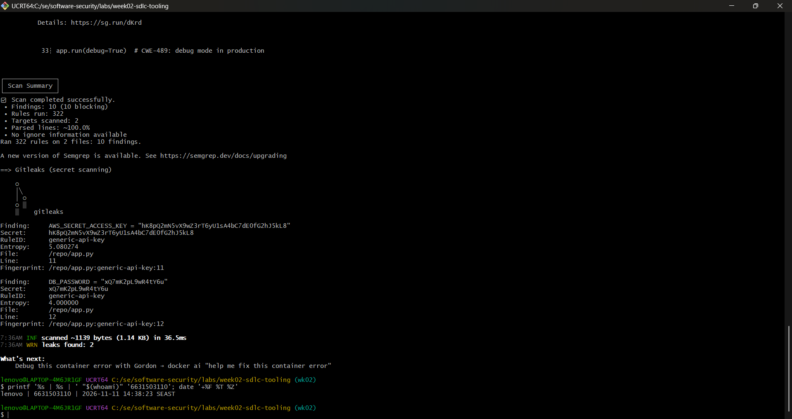


**Task 1 — SAST sweep with Semgrep (25 min)** · *Goal:* find code flaws. *Steps:* read the Semgrep output; locate the SQL injection in `/user` (CWE-89, string-formatted query), the OS command injection in `/ping` (CWE-78, `shell=True`), the weak `md5` password hash (CWE-327), and `debug=True` (CWE-489). *Deliverable:* one screenshot per finding with the file:line.

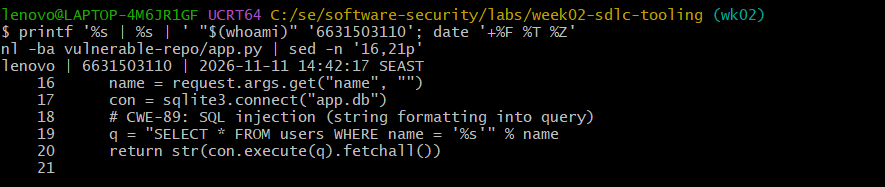
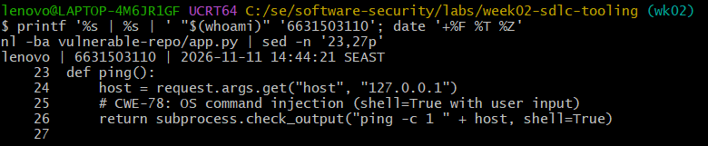
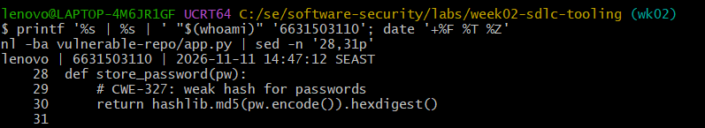
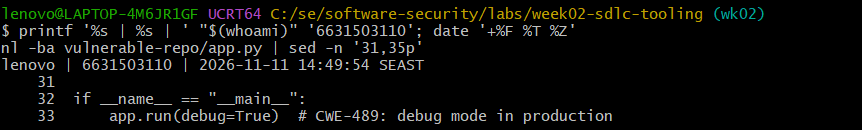

**Task 2 — Secret scan with Gitleaks (15 min)** · *Goal:* find leaked credentials. *Steps:* read the Gitleaks output; identify `AWS_SECRET_ACCESS_KEY` and `DB_PASSWORD` (CWE-798). *Deliverable:* screenshot + the rule that fired for each.

---
Gitleaks detected two hardcoded credentials in app.py: AWS_SECRET_ACCESS_KEY at line 11 and DB_PASSWORD at line 12. Both findings triggered the generic-api-key rule and are classified as CWE-798 (Use of Hard-coded Credentials).

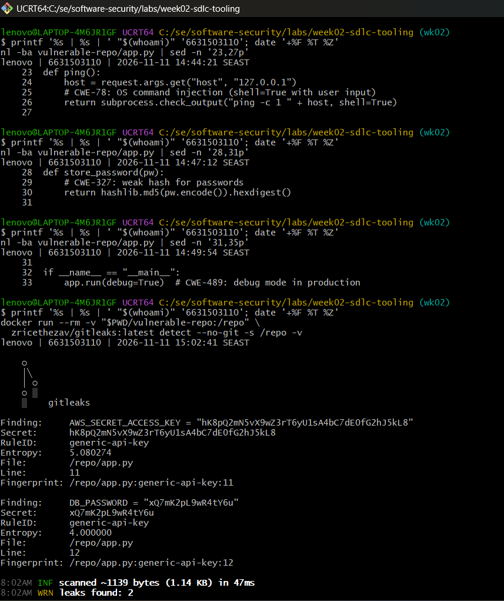
---

**Task 3 — Bug Triage Race (30 min)** · *Goal:* triage accurately. *Steps:* build a table with columns *Tool | File:Line | CWE | Severity | TP/FP | Fix idea*; mark at least 3 true positives and 1 likely false positive and justify each. (Score = TP − misclassified.) *Deliverable:* the completed triage table.

---
Tool	File:Line	CWE	Severity	TP/FP	Fix idea
Semgrep	app.py:19–20	CWE-89	High	TP	Use parameterized SQL queries (?)
Semgrep	app.py:26	CWE-78	High	TP	Remove shell=True and use an argument list
Semgrep	app.py:30	CWE-327	High	TP	Replace MD5 with Argon2 or bcrypt
Semgrep	app.py:33	CWE-489	Medium	TP	Disable debug mode in production
Gitleaks	app.py:11	CWE-798	High	TP	Move AWS credentials to a secret manager
Gitleaks	app.py:12	CWE-798	High	TP	Move DB password to environment variables

Triage Justification
True Positive (TP):
- SQL Injection: User input is directly inserted into an SQL query using string formatting.
- Command Injection: User-controlled input is passed to a shell command with shell=True.
- Weak Hash: MD5 is unsuitable for password storage.
- Debug Mode: debug=True may expose sensitive information.
- Hardcoded Credentials: AWS secret and database password are stored directly in source code.
False Positive (FP):
No confirmed false positives were found in the provided sample. All detected issues were verified against the source code. Duplicate Semgrep alerts were treated as repeated detections of the same vulnerability, not false positives.
---

**Task 4 — Fuzzing intro (10 min)** · *Goal:* see coverage-guided fuzzing find a bug SAST won't. *Steps:* in the `labs/toolbox` container (Apple clang has no libFuzzer runtime), build `clang -g -fsanitize=address,fuzzer harness.c -o fuzz`, then **seed the corpus** and run it:
`mkdir -p corpus && printf 'FUZ' > corpus/seed && ./fuzz corpus`. It crashes almost immediately with an AddressSanitizer heap-buffer-overflow at `harness.c:23` (the `data[3]` read with no `size > 3` check). Seeding matters: an unseeded `./fuzz` has to rediscover the magic bytes by chance and often finds nothing for minutes — that unpredictability is itself worth a sentence in your write-up. (The deep fuzzing+exploit lab is Week 11.) *Deliverable:* the ASan crash output (or a screenshot) + a 2-sentence note on why fuzzing finds this bug when a linter/SAST pass over the same 4-line check would not.

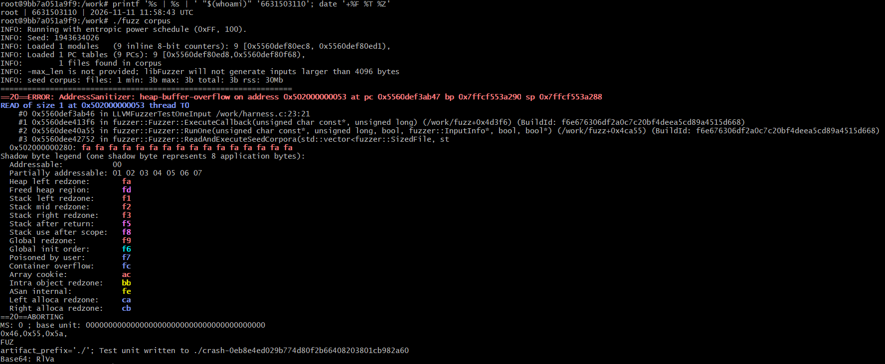

---
Coverage-guided fuzzing uses the seed input to explore program paths and triggers a heap-buffer-overflow when the program reads data[3] without checking the input length. A basic linter or SAST may miss this bug because it depends on runtime input length and execution paths rather than an obvious insecure API or syntax pattern.
---

**Task 5 — Scan the project target (40 min)** · *Goal:* apply the tools to your term project. *Steps:* run Semgrep + Gitleaks against **NoteVault** (`../../project/starter-app`); also run an SCA scan: `docker run --rm -v "$PWD/../../project/starter-app:/src" aquasec/trivy fs /src`. *Deliverable:* a findings list (tool, file:line/CVE, CWE) — reuse it in your project vuln report.

---
1. Findings List
Target: NoteVault (../../project/starter-app)

Tools used: Semgrep, Gitleaks, and Trivy.
A. Semgrep — Static Application Security Testing (SAST)
Semgrep reported 24 findings. Some findings were detected by multiple rules, so related alerts have been consolidated into unique issues.
No.	File:Line	Finding	CWE
1	Dockerfile:12	Container running as root	CWE-250
2	app.py:83	JWT accepts the none algorithm	CWE-347
3	app.py:106–107	Unsafe template rendering	CWE-1336
4	app.py:117, 128	MD5 used for password hashing	CWE-328
5	app.py:134	Hardcoded JWT secret	CWE-798
6	app.py:136	Session cookie missing security attributes	CWE-614, CWE-1004
7	app.py:177–178	SQL Injection	CWE-89
8	app.py:180–181	Unsafe HTML/template rendering	CWE-79, CWE-1336
9	app.py:201–202	OS Command Injection using shell=True	CWE-78
10	app.py:203	Unescaped output returned as HTML	CWE-79
11	app.py:208	Debug mode enabled	CWE-489

B. Gitleaks — Secret Detection
File:Line	Finding	CWE
None	No secrets detected	N/A

Gitleaks scanned approximately 11.18 KB of project files and reported no leaks.
C. Trivy — Software Composition Analysis (SCA)
Trivy identified 41 dependency vulnerabilities in requirements.txt.
Package	Installed Version	Vulnerability (CVE / Advisory)	CWE
Flask	2.0.1	CVE-2023-30861 (High), CVE-2026-27205 (Low)	Not provided
Jinja2	3.0.1	CVE-2024-22195, CVE-2024-34064, CVE-2024-56201, CVE-2024-56326, CVE-2025-27516 (Medium)	Not provided
PyJWT	1.7.1	CVE-2026-102268 (Critical), CVE-2022-29217, CVE-2026-102267, CVE-2026-32597, CVE-2026-48526, GHSA-pxh4-856f-4h89 (High), CVE-2026-101917, CVE-2026-102269, CVE-2026-102270 (Medium)	Not provided
Werkzeug	2.0.1	CVE-2023-25577, CVE-2024-34069 (High), CVE-2023-46136, CVE-2024-49766, CVE-2024-49767, CVE-2025-66221, CVE-2026-102598, CVE-2026-21860, CVE-2026-27199 (Medium), CVE-2023-23934 (Low)	Not provided
requests	2.25.1	CVE-2023-32681, CVE-2024-35195, CVE-2024-47081, CVE-2026-25645 (Medium)	Not provided
urllib3	1.26.4	CVE-2021-33503, CVE-2023-43804, CVE-2025-66418, CVE-2025-66471, CVE-2026-21441, CVE-2026-44431, CVE-2026-97687, CVE-2026-97689 (High), CVE-2023-45803, CVE-2024-37891, CVE-2025-50181 (Medium)	Not provided

Note: Trivy's output did not provide CWE identifiers. Therefore, CWE is marked as "Not provided" rather than assigning unsupported classifications.
2. Overall Summary
The security scans produced the following results:
Tool	Result
Semgrep	24 alerts, consolidated into 11 unique code findings
Gitleaks	No secrets detected
Trivy	41 dependency vulnerabilities

The scans identified several security issues in NoteVault, including SQL injection, OS command injection, weak password hashing, insecure JWT configuration, and vulnerable third-party dependencies. The results can be reused as the initial findings for the project's vulnerability report.

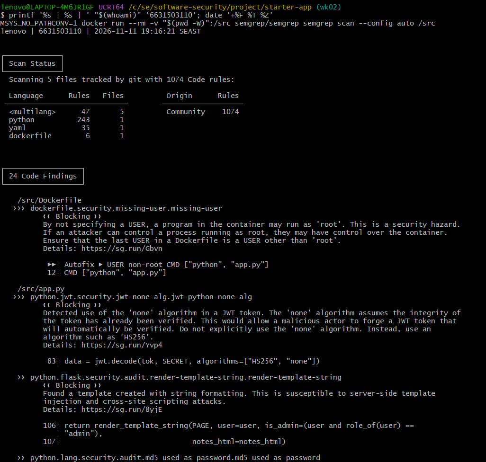
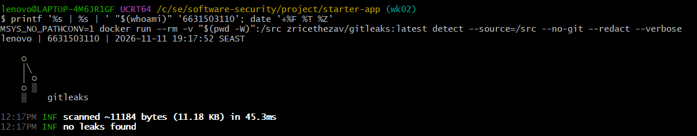
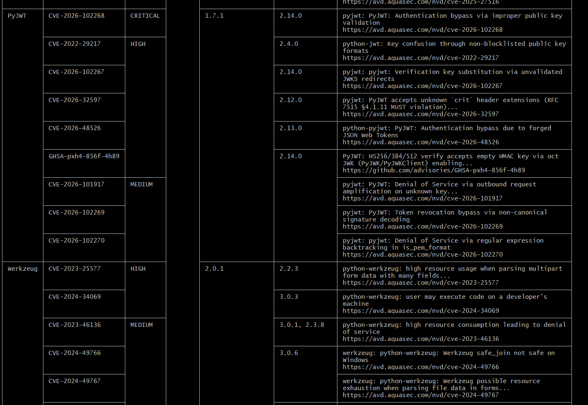
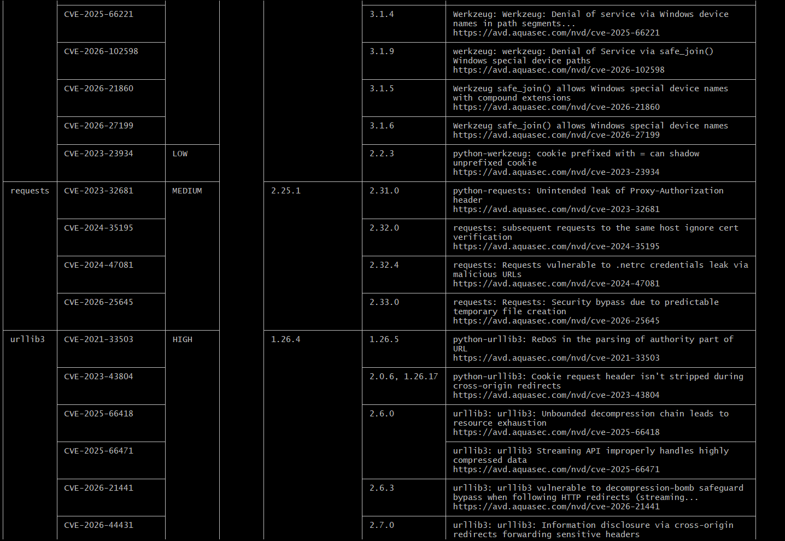
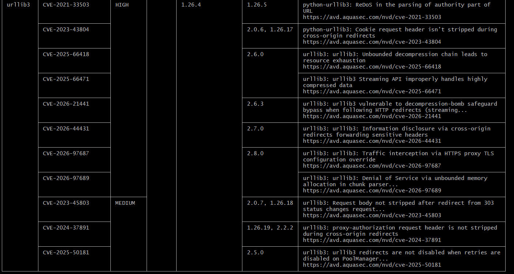

---

**Task 6 — Build a security CI gate (25 min)** · *Goal:* automate the scan (previews Week 15). *Steps:* adapt `../week15-devsecops-pipeline/security-ci.yml` into a workflow that runs Semgrep + Trivy + Gitleaks and **fails on HIGH/CRITICAL**; run it locally (`act`) or commit to your fork and read the Actions log. *Deliverable:* the workflow file + a screenshot of a failing run.
---
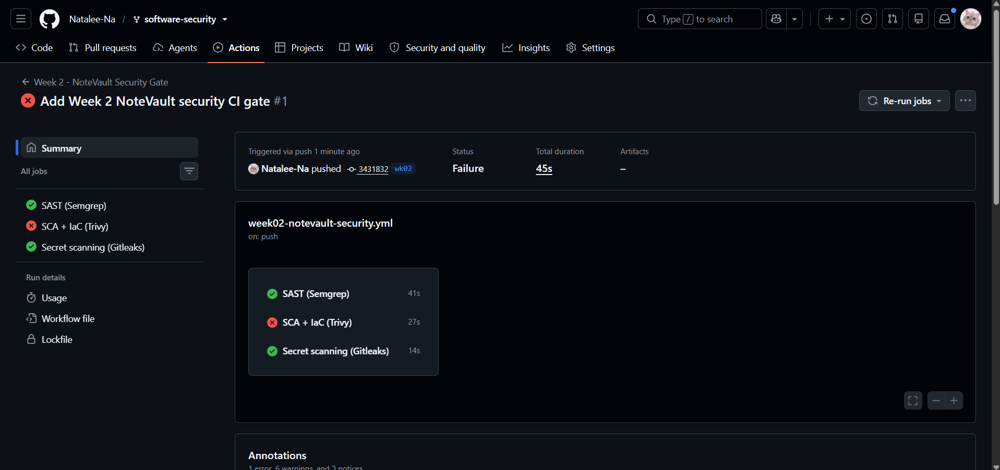
---
**Task 7 — SAST blind spots (20 min)** · *Goal:* see what scanners miss. *Steps:* find one real bug in `vulnerable-repo/app.py` (or NoteVault) that Semgrep did **not** flag, and explain why a pattern-based tool missed it. *Deliverable:* the bug + a 2-sentence explanation.
---

**Bug: Insecure Direct Object Reference (IDOR) / Broken Access Control — `app.py`, lines 160–167.**

The API checks whether a user is authenticated but does not verify that the requested note belongs to that user, allowing any logged-in user to access other users' notes by changing the note ID. Semgrep missed this vulnerability because the SQL query uses parameterized input and the issue is a missing authorization check (business logic flaw) rather than a recognizable dangerous code pattern.

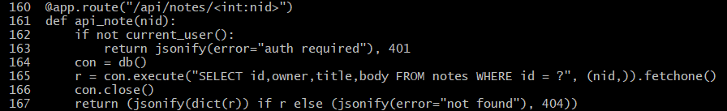

---

**Task 8 — Defend / fix it (10 min)** · *Goal:* remediate the planted flaws in `vulnerable-repo/app.py`. *Steps:* rewrite `/user` to use a parameterized query (`?` placeholder); remove `shell=True` and pass an argument list in `/ping`; move both secrets to environment variables; replace `md5` with bcrypt/argon2; set `debug=False`. *Deliverable:* a before/after diff for each fix mapped to its CWE.

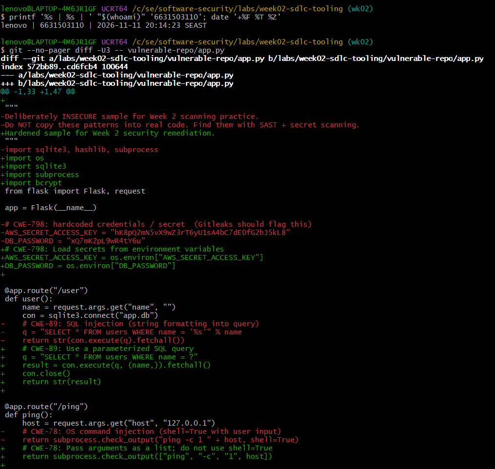
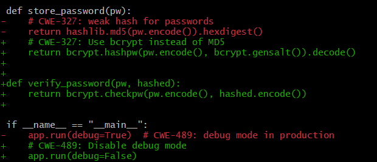
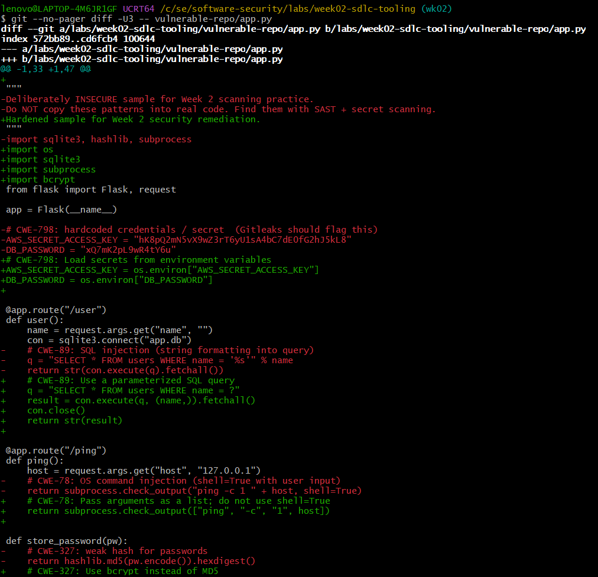
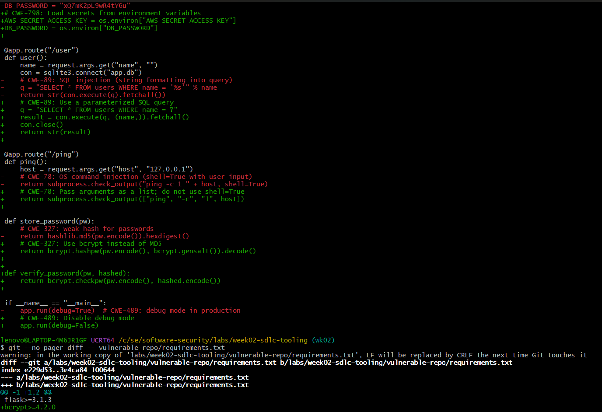
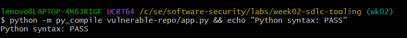


## Part 4 — Reflection
1. Map two of your findings to their CWE and to the matching OWASP 2025 category.

SQL Injection: The /user endpoint used string formatting to build an SQL query from user input. This is CWE-89 (SQL Injection) and maps to OWASP 2025 A05: Injection.


Hardcoded credentials: The application stored AWS and database secrets directly in the source code. This is CWE-798 (Use of Hard-coded Credentials) and maps to OWASP 2025 A07: Authentication Failures.

2. Name a real-world breach caused by a hardcoded/leaked secret or an injection flaw, and what control would have caught it pre-release.

The 2022 Uber security breach involved an attacker using stolen credentials to gain access to Uber's internal systems. The attacker also found hardcoded credentials in internal scripts. Secret scanning in the CI pipeline could have detected those credentials before release, while using environment variables or a secret manager would have prevented them from being stored directly in the code.

3. Which single tool (SAST vs. secret scanning) gave the highest-value findings on this repo, and why?
SAST gave the highest-value findings on this repository because Semgrep identified multiple code vulnerabilities, including SQL injection, command injection, weak password hashing, and unsafe HTML rendering. Gitleaks did not find any exposed secrets in the scanned files, so SAST provided more actionable findings for this particular repository.

## Grading rubric (100)
| Criterion | Points |
|---|---|
| Lecture questions (Part 2) | 20 |
| Exploitation + evidence (scan output + triage table + screenshots) | 40 |
| Defense (remediated `app.py` with before/after diffs) | 25 |
| Reflection (CWE/OWASP mapping + breach + tool value) | 15 |

---

## Evidence & Integrity (required)

- **Identity proof:** every screenshot/diagram must show a terminal running `printf '%s | %s | ' "$(whoami)" '<YOUR-STUDENT-ID>'; date '+%F %T %Z'` **in the
  same image as the evidence**. When the evidence is a browser page, a DevTools panel or a
  rendered response, put that terminal **beside the browser and capture the whole screen** — a
  cropped window carries nothing that identifies you, and the lab's own output is
  byte-identical for the whole cohort *by design*, so the stamp is the only thing that makes
  the shot yours. Generic or borrowed evidence is not accepted.
- **Personalized flag (if this lab issues one):** ____________________
  *Flags are unique per student — submitting another student's flag is a violation. How to submit: **learn.zcr.ai/submit** (full guide: `SUBMISSION.md` in the repo root).*
- **Explain in your own words** *(graded on your reasoning, not copied text):*
  1. What did you do, and **why did the vulnerability work**?
  2. **Why does your fix actually stop it** — and what could still break it?

---

## 🤖 Audit the AI (required)

AI is a power tool you must **distrust** — you are graded on your *critique*, not the AI's answer.

1. Ask an AI assistant to exploit **or** fix this week's vulnerability. Paste its full answer.
Prompt used: "Fix the OS command injection vulnerability in the /ping endpoint of this Python Flask application."

AI's full answer:
The vulnerability occurs because the application concatenates user input into a shell command and executes it with shell=True. An attacker could inject additional commands through the host parameter.

Replace the vulnerable code with:

@app.route("/ping")
def ping():
    host = request.args.get("host", "127.0.0.1")
    return subprocess.check_output(
        ["ping", "-c", "1", host],
        shell=False
    )

Using a list of arguments and setting shell=False prevents the shell from interpreting special characters such as ;, &&, and |. This fixes the command injection vulnerability (CWE-78).

2. **Find what's wrong or risky** in it — insecure code, a subtly incomplete fix, a hallucinated API/function/CVE, a missed edge case, or wrong reasoning. Quote the exact line(s).

The AI correctly removes shell=True and uses an argument list, which prevents shell metacharacters from being interpreted as separate commands. However, it does not validate the user-supplied host value or set a timeout.
host = request.args.get("host", "127.0.0.1")
The application accepts arbitrary input without checking whether it is a valid IP address. An attacker may still supply unexpected command-line arguments, and a ping process could run for an excessive amount of time.

3. Produce the **correct, verified** version yourself and explain in 2–3 sentences why the AI's output was insufficient.

import ipaddress
import subprocess
from flask import request, abort

@app.route("/ping")
def ping():
    host = request.args.get("host", "127.0.0.1")

    # Only allow valid IP addresses
    try:
        ipaddress.ip_address(host)
    except ValueError:
        abort(400, description="Invalid IP address")

    try:
        result = subprocess.run(
            ["ping", "-c", "1", host],
            shell=False,
            timeout=5,
            check=True,
            capture_output=True,
            text=True
        )
        return result.stdout
    except subprocess.TimeoutExpired:
        abort(504, description="Ping timed out")
    except subprocess.CalledProcessError:
        abort(500, description="Ping command failed")

Explanation:

The AI's solution prevents shell injection but does not validate the input or limit how long the subprocess can run. My improved version validates the host as an IP address, uses an argument list with shell=False, and sets a timeout to reduce additional risks.

> Disclose your AI use in the Part 1 table. This task counts toward your **Defense + Reflection** score.

---

## 🧠 Comprehension & Prompt (required)

**A. Explain in Plain English (EiPE).** In 2–3 sentences, in your own words, describe what this week's vulnerable code/endpoint actually *does* and *why it is exploitable* — explain the mechanism, don't dump jargon.

**B. Prompt Problem.** Write a **single prompt** that makes an AI produce a *correct, secure* fix for one finding. Run it: does the exploit now fail? If not, refine the prompt and try again. Submit the **final prompt + the verified result**.
*Graded on the prompt's precision and your verification — this trains problem decomposition and AI literacy (Denny et al. 2024).*
